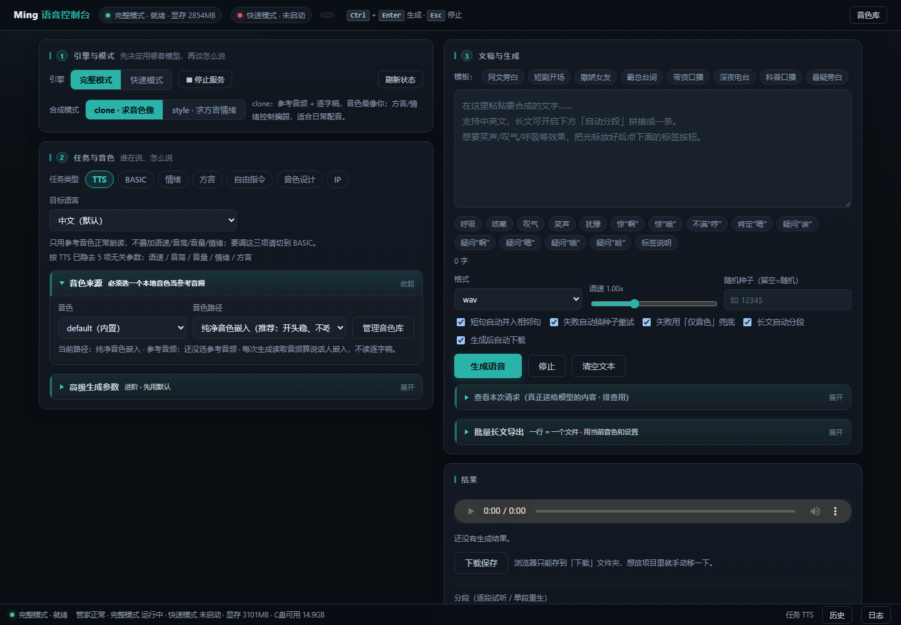

# Ming TTS Console

给 [Ming-3.0-TTS](https://github.com/Alexwell-Chen/Ming-3.0-TTS) 做的一套本地单页控制台：**一个页面 + 一个管家进程**，把「完整模式（官方推理）」和「快速模式（SGLang）」两套引擎的启停、任务选择、音色管理、批量生成、结果试听全部收在一屏里。

面向 Windows + WSL2 + 单张消费级显卡（开发机是 RTX 3060 Laptop 6GB），不依赖任何前端框架，页面是单个 HTML 文件。



## 它解决什么问题

官方仓库给的是推理脚本和 Gradio demo，实际用起来会遇到这些琐事：

- 两套推理栈端口不同（8010 / 8000）、显存互斥，手动 `systemctl` 切换很容易忘；
- 参考音频有 `spk` / `prompt` / `prompt_emb` 三种用法，音色像不像、开头稳不稳完全不一样；
- 短句、长文、情绪、方言、自由指令、音色设计、内置角色（IP）是 7 种不同任务，各自吃的参数不同；
- 生成失败经常不是报错，而是「全是噪音」或「开头丢字」，需要自动重试 + ASR 复核。

这套控制台把这些都做成了页面上的开关和默认策略。

## 功能

- **单端口**：管家监听 `8766`，同时托管页面；双击启动脚本即自动开浏览器，引擎启停全在页面上。
- **两套引擎互斥启停**：完整模式（`8010`，约 3.1GB 显存）/ 快速模式（`8000`，约 5.9GB）；启动一套会自动停另一套。
- **WSL 自检**：每次启动引擎前先探测 WSL，卡死则 `wsl --shutdown` 重置并拉起 keepalive。
- **7 种任务**：TTS / BASIC（语速音高音量）/ EMOTION / DIALECT（粤语、川渝）/ FREEFORM / VOICE_DESIGN / IP（内置音色）。
- **音色三路径**：`spk` 纯净音色嵌入（不读逐字稿、开头稳）、`prompt_emb` 官方零样本克隆（最像）、`prompt` 仅参考音频提示（偶发噪音）。
- **任务能力收敛**：切任务后只显示该任务真正生效的参数，无关项直接从界面消失，请求体也只发有效字段。
- **质量控制**：失败自动换种子重试、时长/音量异常检测、ASR 念字复核（防「全是噪音」）、长文按 24 字分段并复用首段音色。
- **音色库**：参考音频 + 逐字稿存在浏览器 IndexedDB，可保存、试听、删除；自动转写走本机 ASR（`8011`）。
- **内置音色**：233 条内置角色按「角色 → 情绪」聚合成 85 个，用性别 / 年龄 / 语言 / 情绪标签筛选，不用记关键词。
- **其他**：批量长文（一行一个文件）、A/B 对比、请求体查看、生成历史、日志浮层、`Ctrl+Enter` 生成 / `Esc` 停止。

## 架构

```
浏览器（ming-console.html，单文件）
   │  HTTP（同源，127.0.0.1:8766）
   ▼
ming-service-host.py  ── 静态页面 + /start /stop /status ──► wsl.exe (Ubuntu-22.04)
   │                                                          │
   │                                                          ├─ systemd: ming-official → 8010 官方推理
   │                                                          └─ /opt/sglang/start_ming.sh → 8000 SGLang
   │
   └─ /health 轮询、nvidia-smi 显存、C 盘余量
```

## 目录

```
控制台/                   页面 + 管家 + 启动脚本
  config.cmd              唯一的本地配置点（Python 路径、WSL 发行版）
  ming-console.html       单文件控制台（内联 CSS/JS）
  ming-service-host.py    服务管家：静态页面 + 引擎启停 API
  wsl-guard.ps1           WSL 自检 / 重置 / keepalive
  启动Ming控制台.cmd       日常入口：起管家 → 自动开页面
  打开Ming控制台.cmd       备用入口：连 WSL 引擎一起冷启动
  启动Ming-TTS.cmd / 停止Ming-TTS.cmd
服务端/                   跑在 WSL 里的推理服务
  serve_official.py       FastAPI，8010，任务契约 / 分段 / 重试 / ASR 复核
  ming-official.service   systemd unit
  启动脚本/                start_ming.sh、ming-tts.service、ming-asr.service 等
  voice_data.js           内置音色清单（页面数据来源）
```

开发过程笔记（含本机路径、调参记录）不随仓库发布，只留在本地。

## 环境要求

- Windows 11 + WSL2（任意发行版，默认按 `Ubuntu-22.04` 写，可改）
- Python 3.10+ 的 Windows 解释器（用来跑管家；默认按 `C:\Program Files\Python313\python.exe` 写，可改）
- NVIDIA 驱动可用 `nvidia-smi`；6GB 显存起步（两套引擎不能同时常驻）
- 已按 Ming-3.0-TTS 官方说明装好模型与依赖（**本仓库不含模型权重**）
- ASR 可选：`funasr`/`sensevoice` 之类的本机服务跑在 `8011`，没有也能用，只是少了逐字稿自动转写和内容校验

## 快速开始

```bash
git clone https://github.com/Demon5217/ming-tts-console.git
cd ming-tts-console
```

1. **只改一个文件**：打开 `控制台/config.cmd`，改这两项（其余脚本都会 `call` 它）：
   ```bat
   set "PYTHON_EXE=C:\Program Files\Python313\python.exe"
   set "MING_WSL_DISTRO=Ubuntu-22.04"
   ```
   - `PYTHON_EXE`：你的 Windows Python 路径（`where python` 可查）
   - `MING_WSL_DISTRO`：`wsl -l -v` 里看到的发行版名，管家和 `wsl-guard.ps1` 都读这个值
   > 直接用环境变量也行：先 `set MING_WSL_DISTRO=你的发行版` 再启动，脚本不会覆盖已设置的值。
2. 把 `服务端/` 里的 `serve_official.py` 和 systemd unit 部署进 WSL（示例：`/opt/ming-official/`），模型目录、参考音频目录按官方结构放。
3. 双击 `控制台/启动Ming控制台.cmd`，浏览器会打开 `http://127.0.0.1:8766/ming-console.html`。
4. 在页面上点「完整模式」→ 确认冷启动 → 等状态变「就绪」；之后选任务、选音色、贴稿、生成。

### 端口

`8766`（管家 + 页面）、`8010`（完整模式）、`8000`（快速模式）、`8011`（可选 ASR）。改端口要同时改 `ming-service-host.py` 顶部的 `PORT` 和页面里的接口地址。

## 管家 API

| 方法 | 路径 | 说明 |
| --- | --- | --- |
| GET | `/`、`/ming-console.html` | 控制台页面（同目录，`no-store`） |
| GET | `/status` | `{official, fast, vram:{used,free}, c_free_gb, log}` |
| GET | `/health` | 管家自身健康检查 |
| POST | `/start?engine=official\|fast` | 先 WSL 自检，再启引擎并轮询 `/health`（完整模式最长 10 分钟、快速模式最长 25 分钟） |
| POST | `/stop?engine=official\|fast\|all` | 停引擎 |

`官方 /start` 前会检查 C 盘余量，低于 2GB 直接中止。

## 已知限制

- 6GB 显存只够跑一套，两套引擎互斥；切换要重新冷启动（完整模式约 20–60 秒，快速模式 10–15 分钟含 CUDA graph）。
- `fp16` 在这套权重上跑不通（bf16/Half dtype 冲突），只能用默认精度。
- `flow_steps` 外部不可调（官方 `generate()` 不接该参数）；`cfg` 降档反而更慢（实测 1.0→15.6s、1.5→12.2s、2.0→10.7s）。
- 内置音色的性别 / 年龄是从标签文案推断的（`男性（男童）`、`老年` 这类字样），不是模型独立字段。
- 启动脚本是 Windows 批处理 + PowerShell；Linux/macOS 需自行改写入口。

## 许可

代码部分 MIT，见 [LICENSE](LICENSE)。

模型权重、内置音色与参考音频**不在本仓库内**，其许可与使用条款以 Ming-3.0-TTS 官方仓库和模型发布方为准。生成内容的版权与平台合规由使用者自行负责。
